# modbus-timesfm-viewer 取扱説明書

版：v0.1.0

Modbus-TCP に対応した計測機器・データロガーから測定値を読み取り、AI の時系列予測モデル **TimesFM 2.5** で少し先の値を予測するアプリです。実測値は実線で、予測値は破線で、同じグラフにリアルタイムで表示します。

> **免責事項**
>
> - 本ソフトウェアは「現状のまま」提供され、いかなる保証もありません。
> - 本ソフトウェアの使用により生じたいかなる損害についても、作者は責任を負いません。
> - 予測値は AI による推定であり、正確性は保証されません。設備の運転・安全の判断や、法令にもとづく記録には、本ソフトウェアだけを使わないでください。
> - 本ソフトウェアは Google とは関係のない、個人による非公式のツールです。
> - この説明書の画面写真は、見本のデータで撮影したものです。IP アドレス・チャネル名・測定値はすべて架空です。

### 目次

1. [画面の見かた](#1-画面の見かた)
2. [入手と起動](#2-入手と起動)
3. [接続先を設定する](#3-接続先を設定する)
4. [チャネルを登録する](#4-チャネルを登録する)
5. [接続して予測を見る](#5-接続して予測を見る)
6. [予測の設定](#6-予測の設定)
7. [グラフとステータスバーの見かた](#7-グラフとステータスバーの見かた)
8. [設定とログの保存場所](#8-設定とログの保存場所)
9. [困ったとき](#9-困ったとき)
10. [ライセンス](#10-ライセンス)

## 1. 画面の見かた

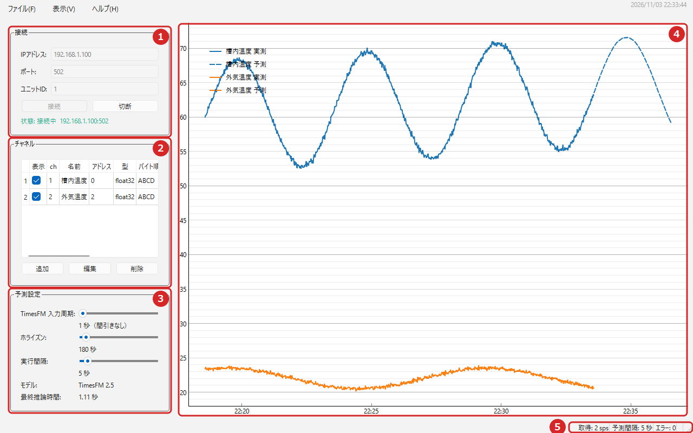

*接続中の画面。青の実線が実測値、右端の青の破線が TimesFM の予測値です*

| 番号 | 名前 | 役目 |
|---|---|---|
| 1 | 接続 | 機器の IP アドレス・ポート・ユニット ID を入れて、「接続」「切断」を押します |
| 2 | チャネル | 読み取るレジスタ（測定値の置き場所）を登録します。表示する線と、予測するチャネルを選びます |
| 3 | 予測設定 | 予測の長さ（ホライズン）や、予測を行う間隔を調整します |
| 4 | グラフ | 実測値（実線）と予測値（破線）を表示します |
| 5 | ステータスバー | 読み取りの速さ・予測間隔・エラーの回数を表示します |

### 動作環境

- Windows 10 / 11（64bit）
- CPU だけで動きます（GPU は不要です）
- インターネット接続は、初回に AI モデルをダウンロードするときだけ必要です
- 空きディスク容量：AI モデルの保存に約 1GB

## 2. 入手と起動

### 2-1. ダウンロードと展開

1. GitHub のリポジトリのページで「Releases」を開き、`modbus-timesfm-viewer-v0.1.0.zip` をダウンロードします。
   - 緑色の「Code」ボタンの「Download ZIP」と、「Source code (zip)」は、開発用のソースです。選ばないでください。
2. ダウンロードした zip を右クリック →「プロパティ」を開きます。下のほうの「許可する」にチェックを入れて「OK」を押します。
3. zip を右クリック →「すべて展開」で展開します。
4. 展開したフォルダの中身は次のとおりです。**`modbus-timesfm-viewer.exe` と `models` フォルダは、同じ場所に置いたままにしてください。**

| ファイル・フォルダ | 内容 |
|---|---|
| `modbus-timesfm-viewer.exe` | アプリ本体 |
| `models` | AI モデルの保存先（最初は空です） |
| `はじめにお読みください.txt` | 使い方の要点 |
| `LICENSE` | ライセンスの本文（GPL-3.0） |
| `THIRD_PARTY_NOTICES.md` | 使っている外部の部品とそのライセンス |
| `取扱説明書.pdf` | この説明書 |

### 2-2. 起動

`modbus-timesfm-viewer.exe` をダブルクリックします。起動するまで、数秒から十数秒かかります。

- 「Windows によって PC が保護されました」と表示されたときは、「詳細情報」→「実行」を押します。このアプリには、Windows の配布元の証明（コード署名）を付けていないため、この表示が出ます。

最初に起動したときは、設定が空の状態で開きます。

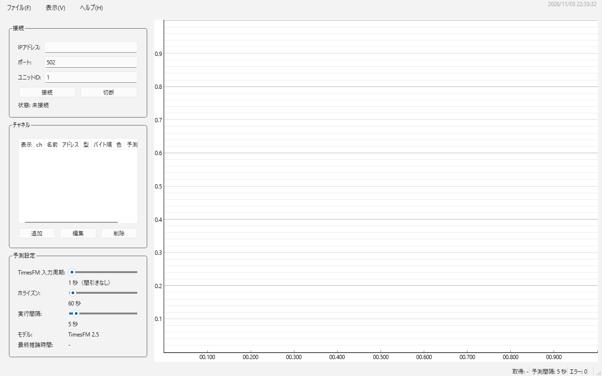

*初めて起動したときの画面。接続先もチャネルも登録されていません*

## 3. 接続先を設定する

画面左上の「接続」欄に、読み取る機器の情報を入れます。値は機器の設定画面や説明書で確かめてください。

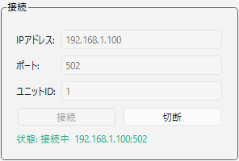

*接続欄（接続中は入力欄が灰色になり、変更できません）*

| 項目 | 入れるもの | 初期値 |
|---|---|---|
| IPアドレス | 機器の IP アドレス（例：`192.168.1.100`） | 空 |
| ポート | Modbus-TCP のポート番号 | 502 |
| ユニットID | 機器のユニット ID（スレーブ ID とも呼びます）。0〜255 | 1 |

- この PC と機器が、同じネットワークにつながっている必要があります。
- この欄の値は「接続」を押したときに保存され、次回の起動時にも表示されます。

## 4. チャネルを登録する

「チャネル」は、機器から読み取る測定値1つ分の設定です。1つのチャネルが、グラフの1本の線になります。

### 4-1. 追加・編集・削除

- **追加**：「追加」を押すと、「チャネル編集」の画面が開きます。
- **編集**：表の行をクリックして選んでから「編集」を押します。
- **削除**：表の行をクリックして選んでから「削除」を押します。確認の画面は出ずに、すぐ消えます。

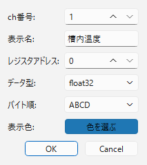

*チャネル編集の画面*

| 項目 | 入れるもの |
|---|---|
| ch番号 | チャネルの番号（1〜100）。ほかのチャネルと同じ番号は使えません |
| 表示名 | グラフの凡例に出す名前（例：槽内温度） |
| レジスタアドレス | 測定値が入っている保持レジスタのアドレス（0〜65535） |
| データ型 | 測定値の形式（下の表を参照） |
| バイト順 | 2つのレジスタにまたがる値の並び順（下の表を参照） |
| 表示色 | 線の色。「色を選ぶ」を押して選びます |

### 4-2. レジスタアドレスの入れかた

このアプリは、機器の **保持レジスタ（Holding Register）** を読みます。アドレスは 0 から数えた番号で入れます。

- 機器の説明書で「40001」「40003」のように書かれている場合、多くの機器では、それぞれ `0`、`2` を入れます。
- 値が読めない、または桁外れの値になるときは、アドレスを 1 つずらして試してください（機器によって数え始めが違います）。

### 4-3. データ型とバイト順

| データ型 | 使うレジスタ | 内容 |
|---|---|---|
| float32 | 2つ | 小数を含む値（32bit 浮動小数点数）。温度などでよく使われます |
| int16 | 1つ | 整数（-32768〜32767） |
| int32 | 2つ | 大きな整数（32bit） |

float32 と int32 は2つのレジスタを使うので、次のチャネルのアドレスは2つ先になります（例：0、2、4…）。

バイト順は、機器によって決まっています。機器の説明書に書かれた順を選んでください。分からないときは、まず `ABCD` を試し、値がおかしければ `CDAB` → `BADC` → `DCBA` の順に試します。int16 はレジスタ1つだけなので、バイト順の設定は使いません（どれを選んでも同じです）。

### 4-4. 表示と予測対象の切り替え

登録したチャネルは表に並びます。表は横に長いので、下のスクロールバーで右へ動かすと「色」「予測対象」の列が見えます。

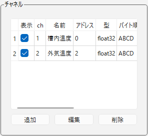

*表の左側。「表示」のチェックを外すと、そのチャネルの線を隠せます*

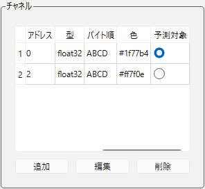

*表の右側。「予測対象」で選んだ1つのチャネルだけを予測します*

- **表示**：チェックを外すと、グラフからそのチャネルの線（実測・予測とも）が消えます。読み取りは続きます。
- **予測対象**：予測するチャネルを1つだけ選びます。予測するのは1チャネルだけです。別のチャネルに切り替えると、前のチャネルの予測線は消えます。

チャネルの追加・編集・削除や、表示・予測対象の切り替えは、その場で保存されます。

## 5. 接続して予測を見る

### 5-1. 接続する

接続先とチャネルを設定したら、「接続」を押します。

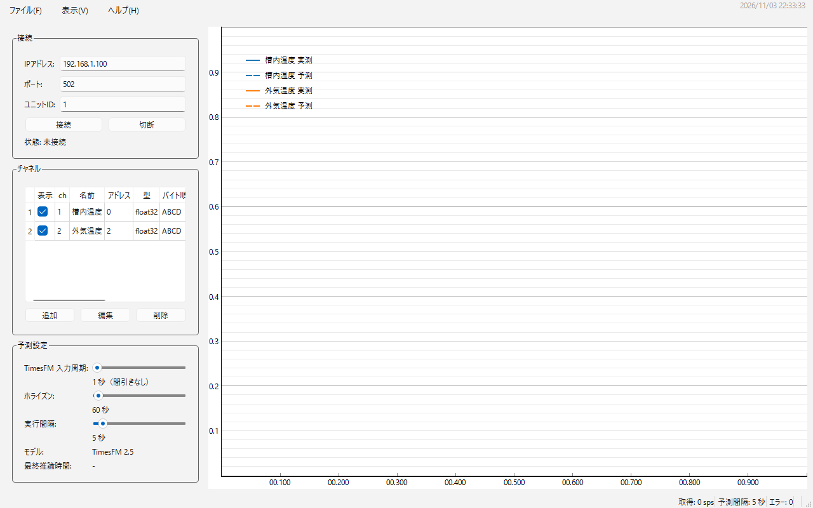

*接続先とチャネルを設定した状態。この状態で「接続」を押します*

接続できると、「状態」が緑の「接続中」になり、グラフに実測値の線が出はじめます。読み取りは、初期設定では1秒に1回です。

### 5-2. 初回は AI モデルをダウンロードする

初めて「接続」を押したときは、AI モデル（約 882MB）を `models` フォルダへダウンロードします。数分かかります。その間、画面下のステータスバーに次の表示が出ます。

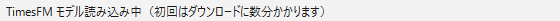

*モデルの読み込み中（初回はダウンロード中）の表示*

- ダウンロードには、インターネット接続が必要です。2回目からは、インターネットにつながっていなくても使えます。
- 機器とつながる PC がインターネットにつながらないときは、別の PC でこのアプリを1度接続してモデルをダウンロードし、`models` フォルダごとコピーしてください。詳しくは、`models` フォルダの中の `モデルのダウンロード方法.txt` を見てください。
- ダウンロードに失敗したときは、30秒ごとに自動でやり直します。

### 5-3. 予測が出るまで

予測には、実測値が 32 点以上必要です。たまるまでの間は、次のように表示されます。

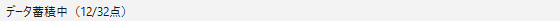

*データがたまるのを待っている表示（たまった数 / 必要な数）*

32 点たまると、予測対象のチャネルの右側に破線の予測値が出ます。そのあとは「実行間隔」ごとに、最新のデータで予測し直します。

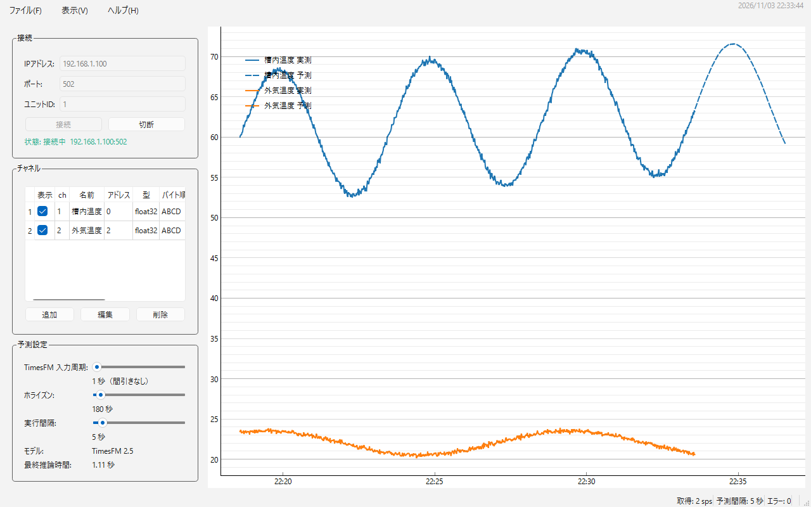

*予測を表示している画面。右端の破線が、この先 180 秒の予測です*

### 5-4. 切断する

「切断」を押すと、読み取りと予測を止めます。グラフはそのまま残ります。もう一度「接続」を押すと、グラフに続けて描きます。予測に使うデータは、新しく読み取った分から数え直します。

## 6. 予測の設定

画面左下の「予測設定」欄で、予測のしかたを変えられます。変更はすぐに次の予測から使われます。

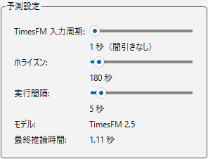

*予測設定の欄*

| 項目 | 内容 | 範囲 | 初期値 |
|---|---|---|---|
| TimesFM 入力周期 | AI に渡すデータの間隔。読み取り周期より長くすると、データを間引いて渡します（「60点に1点」など） | 1〜600 秒 | 1 秒 |
| ホライズン | どれだけ先まで予測するか | 10〜3600 秒 | 60 秒 |
| 実行間隔 | 予測をやり直す間隔 | 1〜60 秒 | 5 秒 |
| モデル | 使っている AI モデル（変更できません） | — | TimesFM 2.5 |
| 最終推論時間 | 直前の予測にかかった時間 | — | — |

### 設定の目安

- AI に渡すデータは、最大で 2048 点です。**入力周期 × 2048** が、AI が見る過去の長さになります。入力周期が1秒なら約34分、60秒なら約34時間です。
- ゆっくり変わる値（温度など）を長く先まで予測したいときは、入力周期を長くします。
- 予測は、ホライズン ÷ 入力周期 の点数で描かれます。たとえば入力周期 1 秒・ホライズン 180 秒なら、180 点です。
- 予測にかかる時間は、PC の性能とホライズンの長さで変わります。最終推論時間が実行間隔より長いときは、実行間隔を長くしてください。

## 7. グラフとステータスバーの見かた

### 7-1. グラフ

横軸は時刻、縦軸は測定値です（画面写真は「5-3. 予測が出るまで」を見てください）。

- **実線**：機器から読み取った実測値です。
- **破線**：TimesFM による予測値です。最新の実測値の続きとして、右側に描かれます。
- **凡例**：グラフ左上に、チャネルの表示名と「実測」「予測」が出ます。
- グラフに描くのは、チャネルごとに新しいほうから 2048 点までです。読み取りが1秒ごとなら、約34分ぶんです。
- グラフの上でマウスのホイールを回すと拡大・縮小、ドラッグすると移動できます。右クリックのメニューの「View All」で、全体の表示に戻せます。

### 7-2. ステータスバー

画面の一番下に、次の表示が出ます。

| 表示 | 内容 |
|---|---|
| 取得: ○ sps | 1秒間に描いた測定値の数（全チャネルの合計） |
| 予測間隔: ○ 秒 | 「実行間隔」の設定値 |
| エラー: ○ | 起動してからのエラーの回数 |
| 最終: 時刻 内容 | 最後に起きたエラーの時刻と内容（エラーがあったときだけ） |

左側には、モデルの読み込み中・データ蓄積中などの、その時の状態が出ます。

### 7-3. 通信が切れたとき

- 機器と通信できないときは、「状態」が「再接続中」になり、自動でつなぎ直します。つなぎ直す間隔は 1 秒から始まり、最大 8 秒まで延びます。
- 3回続けて値が読めなかったときは、いったん接続を切ってから、つなぎ直します。
- つなぎ直しを止めたいときは、「切断」を押します。

## 8. 設定とログの保存場所

| もの | 場所 |
|---|---|
| 設定 | `%USERPROFILE%\.modbus-timesfm-viewer\config.toml` |
| ログ | `%USERPROFILE%\.modbus-timesfm-viewer\logs\app.log` |
| AI モデル | `modbus-timesfm-viewer.exe` と同じ場所の `models` フォルダ |

- `%USERPROFILE%` は、Windows にサインインしている人のフォルダ（例：`C:\Users\あなたの名前`）です。エクスプローラーのアドレス欄に `%USERPROFILE%\.modbus-timesfm-viewer` と入れると開けます。
- 設定ファイルは、最初はありません。「接続」を押したときや、チャネルを変えたときに作られます。窓の位置と大きさ、予測設定は、アプリを閉じたときに保存されます。
- 読み取りの周期は、画面では変えられません。変えたいときは、アプリを閉じてから `config.toml` の `poll_interval_sec`（初期値 1.0 秒）をメモ帳で書き換えます。
- 設定ファイルが壊れて読めないときは、`config.toml.broken` に名前を変えて退避し、初期設定で起動します。
- 設定を最初の状態に戻したいときは、アプリを閉じてから `config.toml` を別の場所へ移します。

## 9. 困ったとき

| 困っていること | 確かめること |
|---|---|
| 「状態」がずっと「再接続中」 | IP アドレス・ポートが正しいか。PC と機器が同じネットワークにあるか。機器の Modbus-TCP が有効になっているか |
| 接続中なのに線が出ない | チャネルを登録しているか。「表示」にチェックが入っているか。ステータスバーの「最終:」にエラーが出ていないか |
| 値が桁外れ・おかしい | データ型とバイト順が機器の説明書と合っているか。レジスタアドレスが1つずれていないか（4-2 を参照） |
| 予測の破線が出ない | 「予測対象」でチャネルを選んでいるか。実測値が 32 点たまったか。モデルの読み込みが終わったか |
| 「モデル読み込み失敗」と出る | インターネットにつながっているか。`models` フォルダが exe と同じ場所にあるか。ディスクの空きが足りているか |
| 予測が実際と大きく外れる | 予測は AI による推定で、外れることがあります。入力周期とホライズンを変えて試してください |

困ったときは、ログ（`app.log`）に詳しい内容が残っています。

## 10. ライセンス

本ソフトウェアは、GNU General Public License v3.0（GPL-3.0）で公開しています。本文は、同梱の `LICENSE` を見てください。

Copyright (C) 2026 Nagasaki-Software

- 利用している外部の部品（PyQt6・pyqtgraph・pymodbus・PyTorch など）と AI モデル（TimesFM 2.5）のライセンスは、同梱の `THIRD_PARTY_NOTICES.md` を見てください。
- 画面の部品に GPL-3.0 の PyQt6 を使っているため、本ソフトウェアも GPL-3.0 にしています。
- TimesFM は、Google Research が公開している時系列予測モデルです。本ソフトウェアは Google とは関係がありません。
